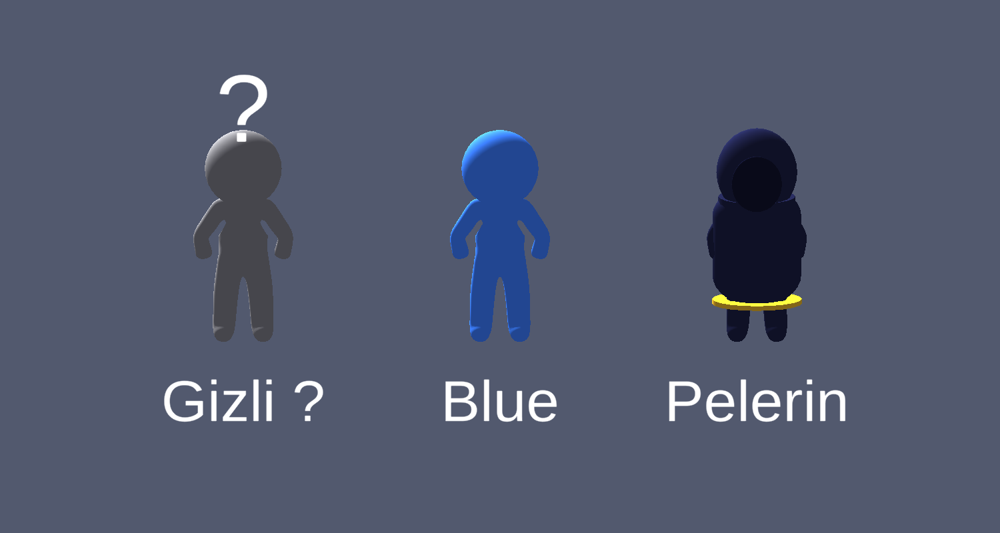

# ZM2b — Pelerin, hamlesiz kalma ve level çözücü

19 Kasım 2026 · Unity **2022.3.19f1** · Yalnız Edit modu; Play'e girilmedi.

**Sonuç:** Derleme ve Console temiz. **77 otomatik Edit kontrolü + 3 kayıtlı UI kontrolü geçti.** Kalıcı 10 levelin tamamında ≥2 farklı kazanan dokunuş dizisi bulundu; bulunan **30 kazanan dizinin tamamı**, her dokunuş arasında hareketlerin bitmesi beklenerek yeniden yürütüldü ve Complete verdi. Çözülemez level çıkmadı.

## Başlangıç temizliği

- Önceki `Test_Cloak`, database'den ve `_Test`'ten kaldırıldı. Boş kalan `_Test` ve `Levels` klasörleri/meta'ları da silindi.
- Database 10 kayıt; `SaveSystem.SetLevelIndex(49)` uygulandı.
- Kod değişikliklerinden önce ve commit öncesinde `git diff --exit-code -- Assets/_BusJam/Data/LevelDatabase.asset` temizdi.
- `M_Purple`, `M_Yellow`, `ArtSource` korunur; commit'e dahil edilmez. Push yok.

## Değişen dosyalar ve gerekçeleri

Yollar aksi belirtilmedikçe `Assets/_BusJam/` altında.

| Dosya | Değişiklik / neden |
| --- | --- |
| `Scripts/Core/FailReason.cs` | Sona `NoMoves` eklendi; mevcut enum değerleri korunur. |
| `Scripts/Core/GameManager.cs` | `PlayingStarted`, Playing durumunun UI yayını tamamlandıktan sonra başlangıç fail kontrolünü tetikler. İç içe StateChanged yayını nedeniyle UI'ın Fail'den tekrar Playing'e dönmesi önlenir. |
| `Scripts/Gameplay/BusStation.cs` | `IsTransitioning`, kapıya geliş ve ayrılan otobüs listesini bildirir. |
| `Scripts/Gameplay/GameplayController.cs` | Mevcut CheckFail noktalarında ve başlangıç/kalkış sonunda durağan durum kontrol edilir. NoSpace önceliği korunur; uygun grid yolcusu kalmadıysa NoMoves gelir. Update/tarama döngüsü eklenmedi. |
| `Scripts/UI/FailPanel.cs` | NoMoves için tam metin: **No moves left!** |
| `Scripts/Level/LevelSolver.cs` + meta | Tamamı `#if UNITY_EDITOR`; oyuncu build'ine girmez. DFS, durum memo'su, farklı dokunuş dizileri ve limitli sonuç. |
| `Scripts/UI/LevelEditorPanel.cs` | `SolveLevel`, taslağın otobüs sırasını okuyup seçilen level numarasıyla çözer; sonucu ayrı TMP metninde gösterir. Çözücü çağrısı Editor koşulunda. |
| `Scripts/Editor/ZM2bVerification.cs` + meta | Tekrar çalıştırılabilen Edit kontrol paketi; bilinen küçük leveller, kazanan sıra replay ve gerçek CheckFail/FailPanel kontrolleri. |
| `Scenes/LevelEditor.unity` | Kaydet ile aynı stilde **Çöz** düğmesi, persistent `SolveLevel` bağlantısı; `SolverResult` TMP referansı bağlı. Mevcut objeler silinmedi. |
| `Materials/M_Cloak.mat`, `M_CloakShade.mat` | `_BaseColor` ve `_Color`: sırasıyla `#1C1F3F`, `#11132A`. Paylaşılan materyaller kullanılır. |
| `Materials/M_CloakGold.mat` + meta | Aynı Simple Lit shader'ından altın `#EFB92A`. |
| `Prefabs/Passenger.prefab` | `Cloak/GoldHem`: collidersız ince cylinder, local konum `(0,-0.43,0)`, ölçek `(0.455,0.012,0.335)`, M_CloakGold. Cloak child'ı olduğu için aynı tween ve aktiflik durumunu kullanır. |
| `Data/Levels/Level_06.asset` | `(2,1)` Pink yolcuya **1 kat ip**. `(3,1)` komşusu ayrılınca açılır; renk, grid ve otobüs sırası değişmedi. |
| `Data/Levels/Level_08.asset` | `(1,1)` White **açık**, `(5,1)` Purple **kapalı** pelerinle başlar. Purple'ın eski hidden özelliği kaldırıldı; hidden+pelerin birleşmez. Renkler, grid ve otobüs sırası aynı. |
| `Docs/MIMARI.md` | Asen'in NoMoves, lacivert/altın görsel, ≥2 çözüm ve Level_06/08 yerleşim kuralları. |
| `Docs/Images/ZM2b-Pelerin-Karsilastirma.png` | Edit modunda gerçek prefab örnekleri ve Camera.Render ile yan yana kayıt. Görsel incelendi. |

Unity'nin sahne/prefab kaydında yeniden sıraladığı YAML blokları eski sıraya getirildi; eski obje kimliklerinin tamamının korunduğu kontrol edildi. Assetlerde yeni ropes/cloak varsayılanlarının yazılması ve eski, artık kullanılmayan waitingSlotCount alanının düşmesi Unity serileştirmesidir.

## Görsel



Gizli yolcunun gri gövdesi ve `?` işareti, Blue'nun canlı mavi gövdesi, pelerinin koyu kukuletası ve ince altın eteği yan yana ayrışıyor. Kayıt için geçici preview sahnesi kullanıldı ve kapatıldı; Game sahnesine karşılaştırma objesi bırakılmadı. Karşılaştırmadaki etiketler ve `?` kameraya çevrildi; prefab'ın oyun içi ikon dönüşü değiştirilmedi.

## NoMoves koşulu

Kontrol Playing dışında, `runningCount > 0` iken veya otobüs geçişi sürerken hemen döner. Aktif otobüs kapıda olmalı; boş koltukla eşleşen slot yolcusu varsa otomatik binişin bitmesi beklenir. Dolu slotlar mevcut NoSpace kuralını kullanır. NoMoves için taşma kuyruğu boş, gridde en az bir yolcu var ve hiçbir Idle yolcu erişilebilir + ipsiz + pelerini açık/pelerinsiz olamaz.

Kapalı pelerin dokunuşu pelerinleri değiştirmez. Kabul edilen dokunuşun koşusu bitmeden fail verilmez. Son otobüsün Complete akışı değişmedi.

## Çözücü

- Durum: grid doluluğu/renk/ip/pelerin, tünel tüketim indeksleri, açık slotlar ve rezervasyonları, koşanlar, FIFO taşma, aktif otobüs, ayrılan/rezerve koltuk sayısı ve kapıya geliş durumu.
- Erişim: çıkıştan dört yönlü flood-fill; yolcular geçişi kapatır. İp komşu ayrılışında azalır; tünel ağız yenilemesi ip çözmez. Pelerin yalnız kabul edilen dokunuşta kalan grid yolcularında döner.
- Otobüs kapasitesi `GameRules.BusCapacity`; slot sayısı gerçek level numarasıyla `GameRules.IsSlotUnlocked` üzerinden hesaplanır. Dolu slotta doğrudan otobüse gidiş yok; bir slot açılacaksa FIFO taşma, aksi halde reddedilen dokunuş; tamamen yerleşmiş dolu slotlar NoSpace.
- Animasyonlar mantıksal varış olaylarıyla temsil edilir. DFS hem varışı beklemeyi hem varıştan önce dokunmayı arar; koşu varışları dokunuş sırasıyla işlenir. Timer, dünya mesafesinden doğan animasyon süreleri ve tween eğrileri simüle edilmez. Bu 10 level için raporlanan 30 kazanan dizinin tamamı ayrıca **hareketler arasında bekleyerek** doğrulandı; zamanlama yarışına ihtiyaçları yok.
- `Dictionary<string, ...>` tam durum anahtarını eşitlikle karşılaştırır; hash çakışması durumları birleştirmez. Aynı koordinat dizisini üreten farklı varış zamanlamaları tek çözüm sayılır. Üst sınır **3 farklı kazanan dizi**.
- Varsayılan sınır **200.000 durum / 5.000 ms**. Limitte 0/1 bulunan çözüm için **Sınır aşıldı (belirsiz)**; asla Çözülemez/Tek çözüm iddiası verilmez. ≥2 bulunduysa bu sonuç zaten kanıtlanmıştır.
- `Result.Solutions` bulunan dizileri, `LosingSequence` istenirse bulunan kilitlenen diziyi verir. Tek çözüm ancak arama tamamlandığında söylenir.

Edit modunda MCP `execute_code` girişleri:

```csharp
return BusJam.LevelEditor.LevelSolver.SolveAll();
```

```csharp
return BusJam.Editor.ZM2bVerification.Run();
```

Tek level / özel limit: `LevelSolver.Solve(level, levelNumber, stateLimit: 200000, milliseconds: 5000, findLosingSequence: true)`. Beklemeli sıra doğrulama: `LevelSolver.ReplaySettled(level, levelNumber, sequence)`.

## Kalıcı 10 level — son tarama

Bulunan sayı 3'te kesilir; toplam çözüm sayısı iddiası değildir. Her satırdaki üç dizinin de beklemeli replay sonucu Complete.

| Level | Sonuç | Bulunan dizi | Aranan durum | Değişiklik |
| --- | --- | ---: | ---: | --- |
| Level_01 | ≥2 çözüm | 3 | 48 | Yok |
| Level_02 | ≥2 çözüm | 3 | 34 | Yok |
| Level_03 | ≥2 çözüm | 3 | 63 | Yok |
| Level_04 | ≥2 çözüm | 3 | 30 | Yok |
| Level_05 | ≥2 çözüm | 3 | 168 | Yok |
| Level_06 | ≥2 çözüm | 3 | 134 | İlk ip: `(2,1)`, 1 kat |
| Level_07 | ≥2 çözüm | 3 | 107 | Yok |
| Level_08 | ≥2 çözüm | 3 | 143 | İlk iki pelerin: `(1,1)` açık, `(5,1)` kapalı |
| Level_09 | ≥2 çözüm | 3 | 135 | Yok |
| Level_10 | ≥2 çözüm | 3 | 405 | Yok |

Çözülemez çıkan eski level olmadığı için çözüm onarımı gerekmedi; yalnız istenen ilk mekanik yerleşimleri yapıldı. Süreler ve otobüs sıraları değiştirilmedi.

## Edit doğrulama

**77 otomatik kontrol:**

- Bilinen küçük leveller: dikey üçlü tek çözüm; yatay üçlü ≥2 ve üç dizi sınırı; bütün pelerinler kapalı / önden ipli kilit çözülemez; komşu ayrılışıyla açılan ip tek çözüm.
- Aynı dizinin varış zamanlaması yüzünden çoğaltılmaması; zaman ve durum sınırı; tünel kuyruğu/ağzın iki kez boşalması.
- Beş slota karşı altıncı slotun Level 50'de, yedincinin Level 100'de açılması; ZD2'nin dolu slot fail'i.
- Test_CloakStuck'ın iki kazanan ve bir kilitlenen sırası; kazananlar Complete, iki normalden sonraki kilit NoMoves.
- On levelin Validate/çözüm kontrolü, ip/pelerinli levelin ≥2 kontrolü ve 30 kazanan sıra replay.
- Gerçek GameplayController.CheckFail: son kapalı pelerin, erişilemez yolcu ve ipli yolcu NoMoves; koşu, otobüs gelişi/kalkışı, biniş bekleyen slot, taşma sırasında erken fail yok; erişilebilir açık yolcu, boş grid ve Start durumunda NoMoves yok; NoSpace ve FailPanel metni korunur.

**3 kayıtlı UI kontrolü:** kaydedilmiş Çöz düğmesinin persistent hedef/metodu, SolverResult bağlantısı ve gerçek SolveLevel çıktısında ≥2 çözüm + koordinat dizisi.

Son Console sorgusu 0 hata / 0 uyarı; Unity idle ve Play kapalı. Script refresh/domain reload sırasında MCP kendi tek yeniden bağlanma denemesiyle toparlandı; kalıcı kopma olmadı. Play/Animator'ın gerçek zamanlı görüntüsü bu kontrolün kapsamı değildir.

## Commit sonrası geçici Play kurulumu — commit dışı

`Assets/_BusJam/Levels/_Test/Test_CloakStuck.asset`; database sonu **indeks 10 / Level 11**. Üç Red yolcu, tek Red otobüs, 120 saniye. Sağ yolcu kapalı pelerinli; diğerleri normal. Validate geçer. Çözücü: **2 kazanan dizi**, 42 durum, limit aşımı yok; kilitlenen dizi de bulundu.

```text
          OTOBÜS / ÇIKIŞ (Red, 3 koltuk)

             x0   x1   x2
      y=0     A    B    C

A, B = normal Red
C    = Red, KAPALI pelerinle başlar
```

**Asen Play:** Game.unity açık ve kayıtlı. Play'e gir, boş alana dokun ve otobüsün kapıda durmasını bekle. Her dokunuştan sonra koşunun/binişin bitmesini bekle.

1. **Kilitlenen sıra: A → B.** A gidince C açılır; B gidince C kapanır. İkinci yolcunun binişi bitince **No moves left!** fail'i gelmeli; otobüs 2/3 dolu kalır. C'ye fazladan dokunmak gerekmez.
2. **Try Again → boş alana dokun → A → C → B.** A gidince C açılır; C açıkken gider; B son koltuğu doldurur ve normal Complete akışı gelir. Diğer kazanan sıra B → C → A.

## Geçici kurulumu geri alma

Play'i durdur. Database'den yalnız Test_CloakStuck girdisini kaldır; `_Test/Test_CloakStuck.asset`/meta'sını sil. Boş kalan `_Test` ve sonra `Levels` klasörlerini/meta'larını kaldır. `BusJam.Save.SaveSystem.SetLevelIndex(49)` uygula. Database 10 kayda dönmeli ve diff temiz olmalı. Bu kurulumdan sonra başka database değişikliği yapılmadıysa `git restore -- Assets/_BusJam/Data/LevelDatabase.asset` aynı database geri almasını yapar. İlgisiz materyal/ArtSource değişikliklerini geri alma.

## Vault

Beyin `note-read`/`note-edit` ile Brief, Mimari ve Kod-Notlari güncellendi; sync başarılı (176 kayıt, uyarı/çakışma yok). **Gorev-Listesi.md** atomik note-edit yazımı yükseltilmiş komutla da **WinError 5 / erişim engellendi** verdi; doğrudan yazarak aşılmadı. Luma 17a/17b kutularını bu rapordaki 80 Edit kontrolüyle işaretlemeli. Oturum kartı ve Kariyer thread'i commit/test kurulumu sonrası aynı protokolle güncellenir.
