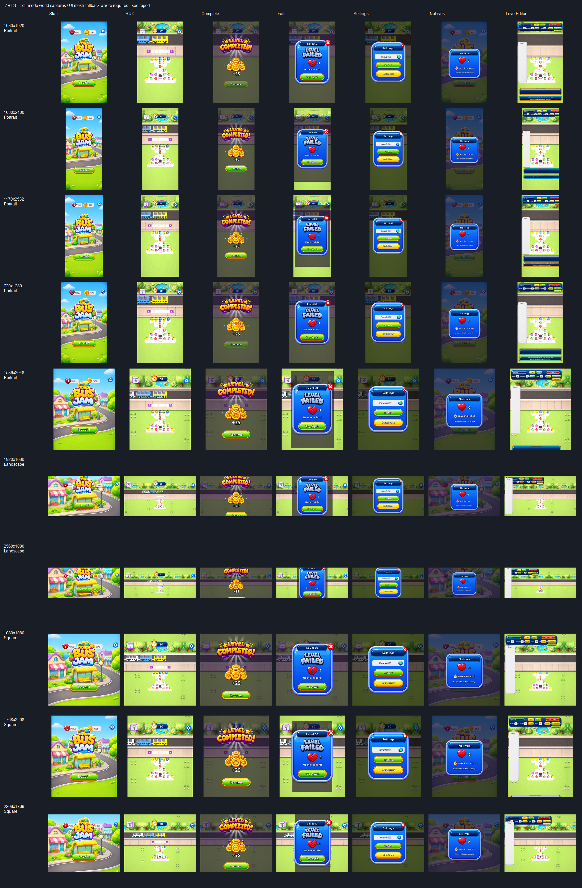
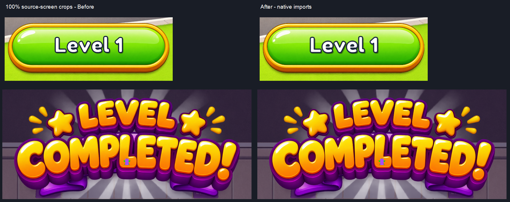

# ZRES — World framing and UI art

20 November 2026. Unity **2022.3.19f1**, branch **main**. Scope: baseline captures, D, E2, F, and camera/background/orientation/window work from E. Edit mode only. No player/APK build, Play entry, push, vault access or branch creation.

## Result and causes

- Added Inspector-bound `CameraFitter`, `LayoutModeController` and `WorldBackground` to Game and LevelEditor. Level builds, safe-area changes and window/resolution changes reframe the world without a restart. The aspect bands are portrait `<0.8`, square `0.8–1.25`, landscape `>1.25`.
- The old gameplay image used Screen Space Camera plus screen-cover scaling. Its changing crop moved the painted road relative to buses and stops. It is retained inactive for reference; the active replacement is textured world geometry.
- The menu artwork could keep a previous canvas size during resizing. `CanvasArtwork` now checks the root canvas dimensions before rendering and refits only when they change. Menu backgrounds remain full bleed.
- UI sources were commonly capped at 512/1024 with ASTC 6x6. Native imports, ASTC 4x4, two atlases and regenerated project SDF fonts remove those avoidable reductions.
- Global sprite packing was disabled. Sprite Atlas V1 is enabled and the validation menu checks that it stays enabled.

## Reference layout preservation

Both cameras retain position **(0, 25.37662, -13.83331)**, Euler **(65, 0, 0)** and **FOV 40** at 1080x1920 and 720x1280. Exact position equality is asserted, rather than accepted with a visual tolerance. The full normalized camera viewport remains enabled: no pillarbox camera rectangle is introduced.

All **260 existing RectTransforms** compare equal to HEAD, including anchors, offsets, positions, sizes, scale and hierarchy references. Sliced Image pixel-density multipliers are the only UI component geometry compensation. Art sampling and font pixels intentionally improve; this is not a claim of identical PNG bytes.

| Scene / canvas | Before | After |
| --- | --- | --- |
| Game / Canvas | Scale With Screen Size, 1080x1920, Match Width Or Height 0.5 | Unchanged |
| LevelEditor / Canvas | Scale With Screen Size, 1080x1920, Match Width Or Height 0.5 | Unchanged |
| Gameplay Background canvases | Screen Space Camera, cover artwork | Retained inactive; world surface active |
| Existing anchors | Game: 160; LevelEditor: 100 | 0 changes |

A, B, C, modal fitting and HUD re-anchoring were explicitly outside this run. [RectTransform comparison](ZRES-Captures/RectTransform-Invariance.txt), [canvas/sliced-image audit](ZRES-Captures/Canvas-and-Slices.txt).

## Camera fit

The serialized design envelope is center `(0, 1, -2.625)`, size `(8.4, 2.6, 15.05)`, including the full 2.2512-unit bus body. Actual level dimensions expand it. Padding is 1.5% per edge. Wider aspects reserve the existing HUD's scaled 310-design-pixel top strip and place the projection centre in the free vertical area. The camera rotation and FOV stay fixed; the transform moves only along its view axis. The reference aspect keeps its original centred projection.

Fit math, in three lines (`q` is a bounds corner relative to the reference camera, in camera axes):

```text
tanY = tan(40°/2); tanX = aspect*tanY; cY = reference ? 0.5 : (bottom+top)/2
d = max(0, maxCorners(q.x/(tanX*xLimit)-q.z, q.y/(2*tanY*(yEdge-cY))-q.z))
cameraPosition = referencePosition-forward*d; projection.m12 = 1-2*cY
```

`xLimit` selects the signed left/right normalized limit; `yEdge` selects bottom/top. Input rays use the same camera projection. Disabling the fitter restores Unity's automatic projection.

`LayoutModeController` compares screen size and safe-area structs without per-frame allocations. Framing and surface extension happen on events. BoardView publishes its completed build so the shared LevelEditor board also reframes. The wider HUD reservation currently reflects the unchanged 0.5 Canvas Scaler; retune it when the excluded UI layout work changes that scaler.

## World-locked road and stops

The ground quad is at world Y `-0.3`; a small textured stop surface is at `-0.299`. Both use the same unlit material and fixed reference-world projection, reproducing the reference artwork placement without binding UVs to the current screen. The mesh expands around the actual camera frustum. Mirrored horizontal texture edges continue the road/curb/sidewalk; the outer grass continues vertically, with a grass blend above the decorative band. No collider or shadow caster is added.

The bus path and Road Center Line share world Z **4.2**. Boarding Door is a child of DoorPoint at local `(-0.12, 0.08, -0.82)`; its stop marker is a child with identical X/Z. Door/stop offsets are measured on the ground plane, since the physical door is above the ground. The artwork's painterly margins are retained; offsets below compare the authored world path and marker geometry, not an image-colour centroid.

Each scene has two textured quads (four triangles), one ground material and the existing background texture. Normal ground pixels need one texture sample; the upper extension blend uses two. No extra edge bitmap, screen-cover gameplay Image or per-frame mesh regeneration is used.

### Resolution evidence

Every row has seven captures: Start, HUD, Complete, Fail, Settings, NoLives and LevelEditor. Conservative 7x9 world-envelope corners pass the padded viewport test in both scenes. The stress check also fits a synthetic 9x12 envelope with simulated safe-area insets; no level asset was edited.

| Resolution | Band | World envelope | Bus/path Z offset | Door/stop XZ offset |
| --- | --- | --- | --- | --- |
| 1080x1920 | Portrait | Pass | 0 | 0 |
| 1080x2400 | Portrait | Pass | 0 | 0 |
| 1170x2532 | Portrait | Pass | 0 | 0 |
| 720x1280 | Portrait | Pass | 0 | 0 |
| 1536x2048 | Portrait | Pass | 0 | 0 |
| 1920x1080 | Landscape | Pass | 0 | 0 |
| 2560x1080 | Landscape | Pass | 0 | 0 |
| 1080x1080 | Square | Pass | 0 | 0 |
| 1768x2208 | Square | Pass | 0 | 0 |
| 2208x1768 | Square | Pass | 0 | 0 |

[Full numeric geometry](ZRES-Captures/Geometry.txt), [260 framing assertions](ZRES-Captures/Checks.txt), [20 menu-background coverage checks](ZRES-Captures/Background-Cover-Checks.txt).



## Import and atlas settings

All 35 UI/background source textures: mipmaps off, Bilinear, alpha transparency on, Read/Write off, NPOT rescaling off. Android and iPhone use ASTC 4x4, quality 100; Standalone uses RGBA32. Every relevant platform maximum reaches the source dimensions. Sources exceeding 2048 use 4096; smaller sources use their next power-of-two cap.

Source-pixel 9-slice borders are unchanged and validated against source dimensions. Existing sliced Images receive the imported-height / pixel-density compensation needed to retain reference corner thickness. Details are in the canvas/slice audit linked above.

| Texture | Source px | Old max / mobile format | New max | RGBA32 MiB | ASTC 4x4 MiB |
| --- | --- | --- | --- | --- | --- |
| badge_level.png | 1229x1255 | 1024/ASTC_6x6 | 2048 | 5.88 | 1.48 |
| btn_green.png | 2179x719 | 1024/ASTC_6x6 | 4096 | 5.98 | 1.50 |
| btn_red.png | 2161x727 | 1024/ASTC_6x6 | 4096 | 5.99 | 1.50 |
| btn_round_blue.png | 1211x1239 | 1024/ASTC_6x6 | 2048 | 5.72 | 1.43 |
| btn_settings.png | 512x512 | 512/ASTC_6x6 | 512 | 1.00 | 0.25 |
| btn_yellow.png | 2153x682 | 1024/ASTC_6x6 | 4096 | 5.60 | 1.41 |
| coin_pile.png | 1361x998 | 1024/ASTC_6x6 | 2048 | 5.18 | 1.30 |
| counter_plate.png | 2172x724 | 1024/ASTC_6x6 | 4096 | 6.00 | 1.50 |
| editor_void_marker.png | 128x128 | 2048/AutomaticCompressed | 128 | 0.06 | 0.02 |
| fx_confetti_rect.png | 256x256 | 256/ASTC_6x6 | 256 | 0.25 | 0.06 |
| fx_confetti_star.png | 256x256 | 256/ASTC_6x6 | 256 | 0.25 | 0.06 |
| fx_sparkle.png | 1137x966 | 512/ASTC_6x6 | 2048 | 4.19 | 1.05 |
| fx_tap_hand.png | 369x512 | 512/ASTC_6x6 | 512 | 0.72 | 0.18 |
| glow_rays.png | 1470x1040 | 1024/ASTC_6x6 | 2048 | 5.83 | 1.46 |
| glow_soft.png | 256x256 | 256/ASTC_6x6 | 256 | 0.25 | 0.06 |
| icon_angry.png | 512x467 | 512/ASTC_6x6 | 512 | 0.91 | 0.23 |
| icon_clock.png | 975x1247 | 512/ASTC_6x6 | 2048 | 4.64 | 1.16 |
| icon_close.png | 1061x1175 | 512/ASTC_6x6 | 2048 | 4.76 | 1.19 |
| icon_coin.png | 1182x1234 | 512/ASTC_6x6 | 2048 | 5.56 | 1.40 |
| icon_heart.png | 1252x1169 | 512/ASTC_6x6 | 2048 | 5.58 | 1.40 |
| icon_heart_broken.png | 1293x1151 | 512/ASTC_6x6 | 2048 | 5.68 | 1.42 |
| icon_plus.png | 1120x1162 | 512/ASTC_6x6 | 2048 | 4.96 | 1.24 |
| icon_restart.png | 1165x1178 | 512/ASTC_6x6 | 2048 | 5.24 | 1.31 |
| panel_header.png | 2188x702 | 1024/ASTC_6x6 | 4096 | 5.86 | 1.47 |
| panel_inner.png | 1552x1040 | 1024/ASTC_6x6 | 2048 | 6.16 | 1.54 |
| panel_modal.png | 1138x1410 | 1024/ASTC_6x6 | 2048 | 6.12 | 1.54 |
| panel_tip.png | 2188x695 | 1024/ASTC_6x6 | 4096 | 5.80 | 1.45 |
| Renkli Bus Jam Oyun Logosu.png | 1774x887 | 2048/AutomaticCompressed | 2048 | 6.00 | 1.50 |
| ribbon_purple.png | 1525x652 | 1024/ASTC_6x6 | 2048 | 3.79 | 0.95 |
| title_complete.png | 1737x815 | 1024/ASTC_6x6 | 2048 | 5.40 | 1.35 |
| title_failed.png | 1504x854 | 1024/ASTC_6x6 | 2048 | 4.90 | 1.23 |
| ui_passenger_icon.png | 128x128 | 128/AutomaticCompressed | 128 | 0.06 | 0.02 |
| bg_game.png | 941x1672 | 2048/ASTC_6x6 | 2048 | 6.00 | 1.51 |
| bg_menu.png | 941x1671 | 2048/ASTC_6x6 | 2048 | 6.00 | 1.51 |
| GameBG.png | 941x1672 | 2048/AutomaticCompressed | 2048 | 6.00 | 1.51 |

### Packed cost (editor-derived estimates)

| Atlas | Packed pages | Android/iPhone ASTC 4x4 | Standalone RGBA32 |
| --- | --- | --- | --- |
| UI_Icons | 4096x4096 + 4096x1024 | 20 MiB | 80 MiB |
| UI_Panels | 4096x4096 + 4096x1024 | 20 MiB | 80 MiB |
| Total | Four pages, two atlas assets | **40 MiB** | **160 MiB** |

Both atlases are included, use Bilinear, no mipmaps, no Read/Write, four-pixel packing padding, no rotation and no tight packing. These are packed-page block-storage estimates, not an APK/download-size claim. Unity's preview texture wrapper reports only a small wrapper allocation, so that value is not presented as GPU memory. Source texture costs in the table should not automatically be added to the atlas total: player stripping and residency were not measured because builds were prohibited. [Packed dimensions](ZRES-Captures/Atlases.txt).

Both project fonts changed from sampling 64 / padding 9 / 1024x1024 to **sampling 96 / padding 14 / 2048x2048 Alpha8**. Fredoka retains 191 characters; LilitaOne retains 190 and its Fredoka fallback. Asset GUIDs and shared material identities remain. Atlas storage is 4 MiB GPU per font; the editor reports approximately 8 MiB per texture including its readable CPU copy. [Font measurements](ZRES-Captures/Fonts.txt).

`Bus Jam > Validate UI Import` rejects undersized sources or atlas caps, mipmaps, Read/Write, wrong filtering/transparency, wrong platform formats/quality, invalid borders and disabled atlas packing. Negative checks rejected a 512 cap on btn_green, mipmaps enabled, ASTC 6x6, and a 2048 cap on the panel atlas; all settings were restored and validation passes. [Validation evidence](ZRES-Captures/Import-Checks.txt).



## Capture method and limits

The seven baseline PNGs were captured before the world/import changes at 1080x1920. Final captures use fixed-size Unity Game view render targets and disposable production-prefab fixtures in Edit mode. They do not run gameplay, animations, saves or lives regeneration. Baseline Complete contains residual fixture board geometry that was later removed by strengthened preview cleanup; compare its UI art/layout, rather than treating those passengers as a production Complete state.

An unfocused editor intermittently stopped emitting the native overlay batch. Where that happens, the capture helper draws the current CanvasRenderer quad meshes with their original UI materials and SDF atlas over the Game view world render. This editor-only fallback is disclosed here: it is a visualization of the existing UI geometry, not Play-mode or complete stencil/scroll-clipping acceptance. No saved UI object is created or re-anchored. Native window inspection through Computer Use was not approved; Unity MCP remained available.

The final contact sheet contains 70 dimension-checked captures. Reference button/title crops are unscaled screen pixels. All disposable preview roots are removed after capture, including orphaned DontSave roots across reloads.

### Remaining visual review

- The excluded UI work is still needed: Complete's upper title and Fail's panel can clip in landscape, some modal dims retain a design-sized area after resizing, and LevelEditor's lower controls can leave the viewport on wider/tablet layouts. No all-UI safe-area/collision certification is claimed.
- The portrait-authored board remains vertically arranged on wide screens; the camera uses the free area and the road/grass fill the remaining width. Repeated decorative texture edges may warrant art direction.
- Physical bus/door motion, actual device rotation/notches, window resizing in a player and animation pacing remain untested under the explicit Edit-only/no-build restriction. The resize events, projection/bounds and world-anchor invariants were checked in the editor.
- Desktop RGBA32 atlas storage is deliberately substantial (160 MiB) to prioritize crispness. BC7 is an allowed future desktop memory tradeoff.

## Delivery checks

Unity 2022.3.19f1 compilation succeeds. The framing suite passes 260 assertions; source/atlas validation passes and four negative faults are rejected; menu cover passes 20 checks. Console is cleared only after inspecting the verification messages and is left at zero entries. Game is restored at 1080x1920, Start visible, without preview objects.

The existing LevelDatabase, Level_26, M_Purple, M_Yellow, URP-Mobile, ArtSource and Otobus Materials work is excluded from staging. One English commit on main; no push.
